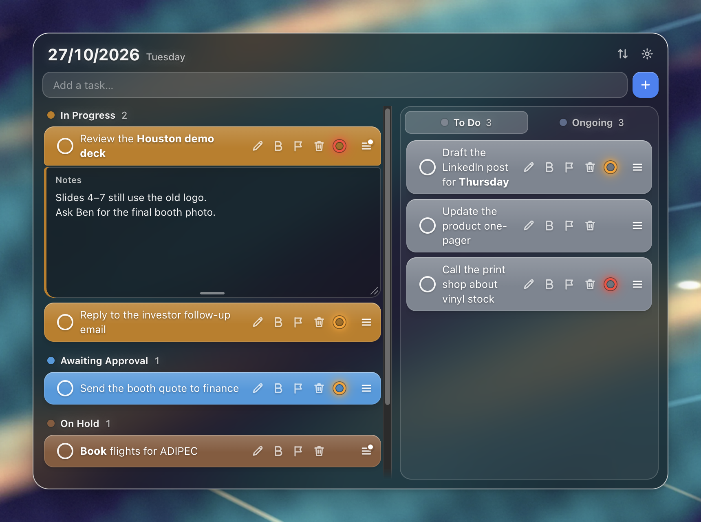
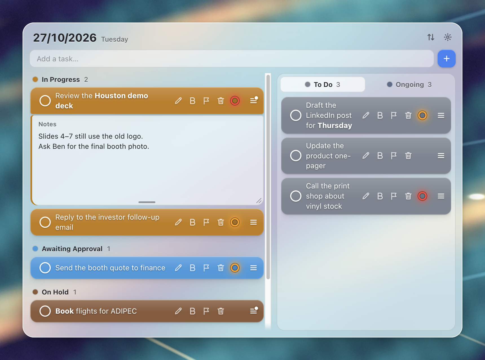
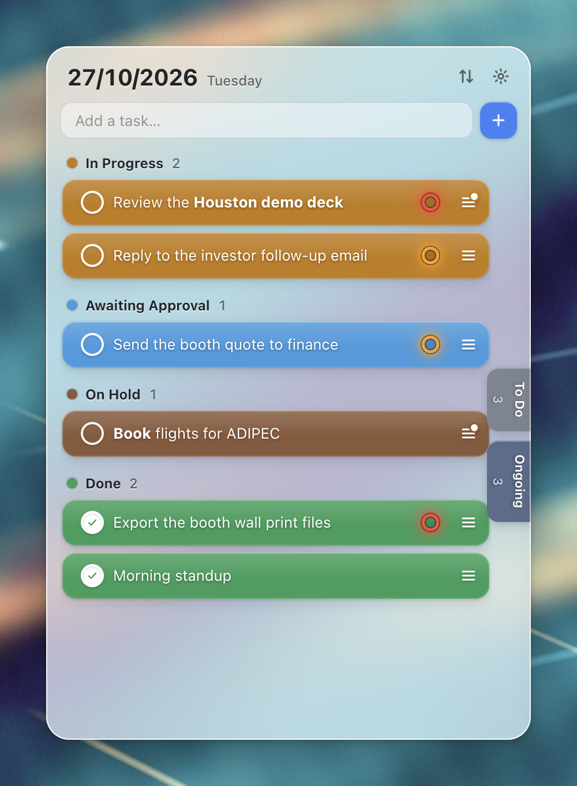
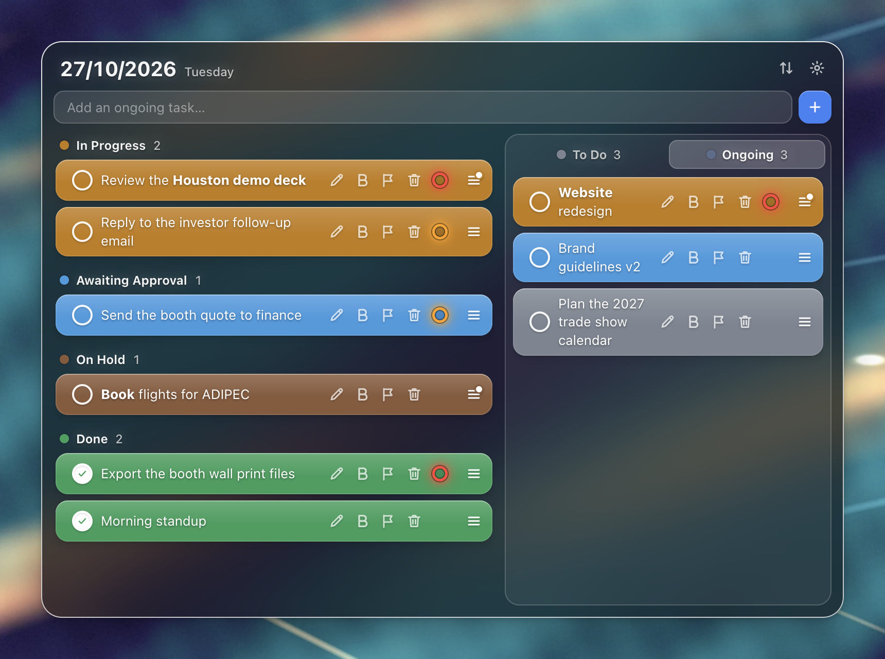
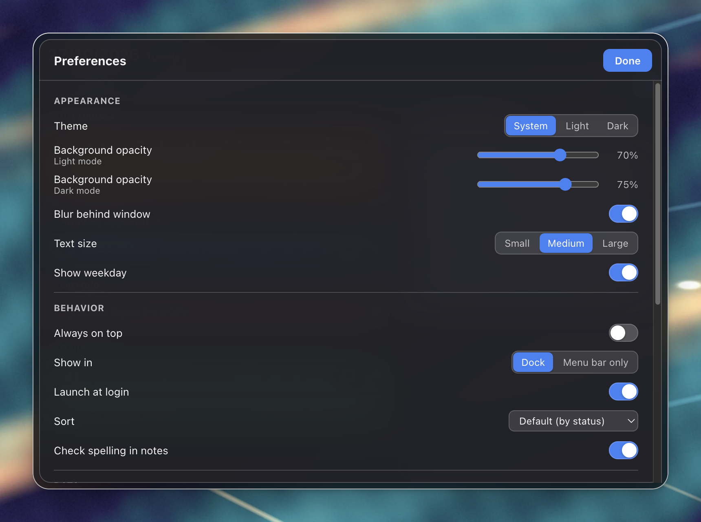

# ClearDay

A compact, Monday-style daily task board that floats on your Mac desktop.
One window, one day: set what's in progress, what's waiting for approval,
what's on hold and what's done, with the to-do list and your long-term
projects beside it.



| Light | Compact |
|---|---|
|  |  |

| Ongoing projects | Preferences |
|---|---|
|  |  |

## Features

- **Translucent window.** The desktop shows through a blurred background. You
  set how see-through it is, separately for Light and Dark. It has Light,
  Dark and Follow System themes.
- **Statuses fill the row.** Click the round button on a row and pick To Do,
  In Progress, Awaiting Approval, On Hold or Done. The whole row takes that
  colour.
- **To Do in its own panel.** The board lists In Progress first, then
  Awaiting Approval, then On Hold, then Done. A row moves to its new section,
  animated, when its status changes.
- **Ongoing projects.** Long-term work lives in an Ongoing tab beside To Do.
  - Its tasks keep their own statuses but stay off today's board.
  - Move a task between Today and Ongoing from the status picker, or by
    dragging it.
  - New tasks go to whichever tab is open.
- **Priority rings.** Mark a task High (red) or Medium (orange) and a
  glowing ring appears on its right.
- **Partial bold.** Select a word and press ⌘B or the B button. With nothing
  selected, B bolds the whole row.
- **Notes.** The ≡ button opens a notes panel attached under the task, and
  the same button closes it.
  - It saves as you type and resizes from its bottom edge.
  - Right-click in a note for spelling suggestions, Look Up, speech, and
    writing direction: left to right or right to left, kept per note.
- **Responsive layout.**
  - A wide window shows the board and the To Do panel side by side.
  - A narrow window shows one column, with To Do in a drawer on the right
    edge and the row tools behind "…".
  - In the narrow layout, To Do and Ongoing each get a tab on the right edge.
- **Sorting.** Default (by status), By priority, By creation time, or Manual.
  Default and Manual let you drag rows to reorder them, and drag rows between
  To Do and the board.
- **Undo.** A deleted task can be restored from the toast or with ⌘Z.
- **Your day carries over.** At midnight only the date changes. Nothing is
  cleared or archived.
- **Preferences** (the gear, or ⌘,):
  - Appearance: theme, background opacity for Light and Dark, blur, text size
    and the weekday.
  - Behavior: always on top, Dock or menu bar only, launch at login, sort and
    spell checking.
  - Data: show the data folder, export your tasks, reset the window position.
  - A list of keyboard shortcuts.

### Keyboard

| Key | Action |
|---|---|
| Enter | Add the task you typed. On a selected row, edit it |
| ⌘N | Jump to the add field |
| ↑ / ↓ | Select a row |
| ⌘B | Bold the selection, or the whole row |
| ⌘⌫ | Delete the selected task |
| ⌘Z | Undo the last delete |
| ⌘, | Preferences |
| Esc | Cancel an edit, or close a picker, the drawer or Preferences |

## Install

ClearDay needs macOS 13 or later. It isn't notarized, so build it yourself:

```bash
git clone https://github.com/NoamElyasim/clearday.git
cd clearday
npm install
npm run install:mac      # builds, signs locally, copies to /Applications, opens it
```

## Develop

```bash
npm start                # run from source
npm test                 # unit tests for the task model
npm run e2e              # drives the real UI with clicks, keys and drags
npm run shots            # renders every look to tools/shots/out/
npm run shots -- --docs  # …and refreshes the README images
```

`CLEARDAY_USER_DATA=/some/folder npm start` runs against a scratch board.
Running it that way leaves your real board untouched.

### Layout

```
src/main/       main process: window, menus, tray, settings, task store, right-click menu
src/preload.cjs the renderer's API (window.clearday)
src/shared/     the task model: plain functions shared by both sides
src/renderer/   the UI; theme.css holds every colour
```

### Data

Tasks are kept in `~/Library/Application Support/ClearDay/tasks.json`. The
format is plain, versioned JSON, ready for syncing to a phone later:

- every task has an ID, a `createdAt` and an `updatedAt` timestamp
- deleted tasks are kept as tombstones for 30 days

Window size, theme and the other settings live in a separate
`settings.json`, because they belong to this Mac.

## License

[MIT](LICENSE)
